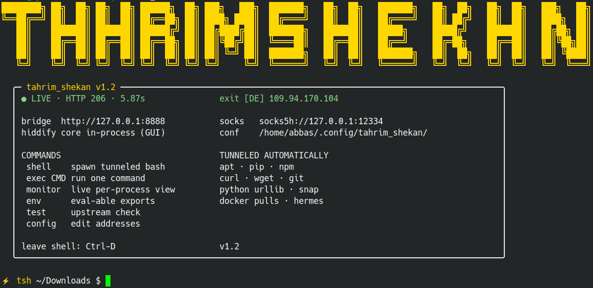

<div align="center">



**A sanctions-bypass shell for Linux desktops.**
One prefix — or one shell — routes `apt`, `pip`, `npm`, `curl`, `git`, `snap` and any
Python `urllib` app through your local proxy, so blocked downloads (GitHub release
assets, Chrome-for-Testing, pip packages, Docker layers…) just work.

</div>

## Why

Sanctioned-region users lose access at the **IP level**: cdns and registries return
`HTTP 403` outright. Your proxy client (Hiddify etc.) exposes a **SOCKS5** port — but
half the tooling you need (python `urllib`, `apt`, many npm/docker configs) only speaks
**HTTP proxy** and cannot use SOCKS. `tahrim_shekan` closes that gap and wraps the whole
thing in a usable CLI.

```
apps → tahrim-bridge :8888 (http) → Hiddify :12334 (socks5) → exit node → internet
```

- **`tahrim-bridge`** — a ~100-line, stdlib-only HTTP↔SOCKS5 converter, shipped as a
  systemd *user* service with linger: it starts at boot, needs no root, and survives
  logout.
- **`tahrim_shekan`** — the front-end: tunneled shells, one-shot command execution, a
  live status panel, and a per-process monitor.

## Install

Prerequisite: a SOCKS5 proxy listening on `127.0.0.1:12334` (Hiddify's default port).
Anything else — edit addresses with `tahrim_shekan config`.

```bash
git clone https://github.com/Apex133/tahrim_shekan.git
cd tahrim_shekan
./install.sh
```

User-level only: `~/.local/bin`, `~/.local/share`, `~/.config/systemd/user`. No root.

## Usage

| Command | What it does |
|---|---|
| `tahrim_shekan` | status panel — live probe, latency, exit IP/country |
| `tahrim_shekan shell` | tunneled bash (`⚡ tsh ~ $`) — apt/pip/npm/curl/python just work |
| `tahrim_shekan exec CMD` | run one command through the tunnel |
| `tahrim_shekan monitor` | live view: which processes use the tunnel, and via what |
| `tahrim_shekan env` | eval-able proxy exports for your current shell |
| `tahrim_shekan test` | quick upstream check |
| `tahrim_shekan config` | edit proxy addresses |

Example — the original use case, downloading a Playwright/Chromium build that 403s on
sanctioned IPs:

```bash
tahrim_shekan exec hermes pm install agent-browser
```

### Monitor

`tahrim_shekan monitor` refreshes every second and attributes every tunneled
connection to its owning process, separating bridge clients from direct SOCKS users:

```
⟐ tahrim monitor · 01:08:37 · bridge pid 38965 · Ctrl-C stops
PID      PROCESS                CONNS  VIA
48064    curl                   1      bridge
3137     firefox                5      socks
bridge → node: 1 active tunnels
```

## Uninstall

```bash
systemctl --user disable --now tahrim-bridge.service
rm ~/.local/bin/tahrim_shekan ~/.local/share/tahrim_shekan/bridge.py \
   ~/.config/systemd/user/tahrim-bridge.service
```

## License

MIT
